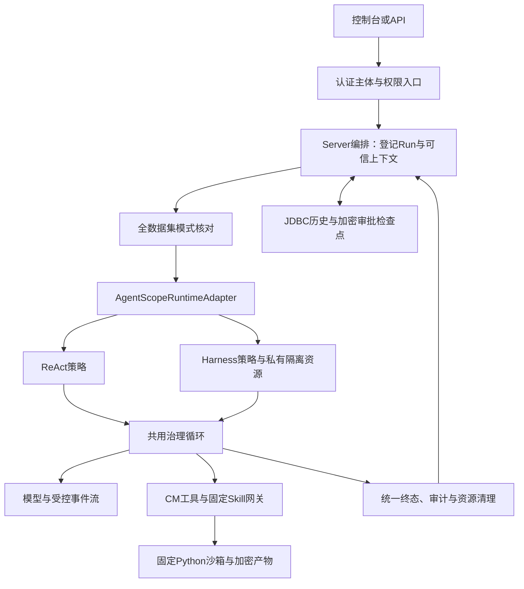

# Harness 模块设计与接入说明

整合日期：2026-10-13；文档修订：R0。适用仓库：CM Agent，AgentScope Java 2.0.2。

本文按模块职责整合原架构分析、兼容实验、入口收紧、T2–T6实施及部署接续文档。阅读当前功能、边界和接入方式以本文为入口；阶段原文保留在 `docs/superpowers`，用于追溯当时的决定、失败和验收证据。本文中的验收结果来自已记录的阶段验证，文档整合本身没有重新执行这些测试。

## 1. 当前结论与采用范围

CM Agent 已完成首批受控 Harness 的代码接入及 T2–T6 验收。它在现有运行时中增加可选择的 Harness 策略，复用认证、多租户、RBAC、工具授权、审计、会话历史、审批、Skill、Python沙箱及加密产物链。

| 项目 | 当前采用结果 | 证据边界 |
|---|---|---|
| 依赖版本 | Core、Harness、Provider、Studio等 `io.agentscope` 构件统一2.0.2 | 2.0.4候选与早期实验保留为历史，不是正式运行版本 |
| 仓库默认策略 | `react`；显式配置可选择 `harness` | 不是按Agent、租户或HTTP请求动态切换 |
| 功能接入 | 执行器、隔离、审批/状态/停止、Skill/沙箱/产物、只读上下文已实现并有阶段验收 | 不开放Harness全部原生能力 |
| 本机启用 | 2026-10-13接续账本记录Windows、JDK21、`mysql`开发profile、真实Harness；数据库为Rocky MySQL | 登录和现有DeepSeek无工具Run成功；是该次运行记录，不是持续健康保证 |
| Rocky生产部署 | 装配及旧产物密文副本已准备，正式部署未完成 | 七个生产Secret、真实认证恢复和正式入口等条件仍未闭合 |
| 后续能力 | T7上下文压缩；T8长期记忆、子Agent、计划、持续工作区 | 首批范围外，尚未实施，需独立定义权限和验收 |

旧架构清单中的“T2–T6待做”、兼容实验中的“生产准入未通过”均表示各自阶段当时的事实。当前实现采用后续阶段账本；本机启用也不能替代Rocky生产准入。

## 2. 模块分工与调用链

| Maven模块/位置 | Harness相关职责 | 关键入口 |
|---|---|---|
| `cm-agent-api` | 沿用公共主体、租户、分页及错误类型 | 不把AgentScope类型或密钥暴露给公共API |
| `cm-agent-core` | 运行请求/结果、Runtime能力、工具/Skill网关、只读快照、系统模式仓储SPI | `AgentRuntime`、`RuntimeExecutionModeRepository`、`WorkspaceContextSnapshot` |
| `cm-agent-agentscope-adapter` | ReAct/Harness策略、模型/工具桥接、事件映射、隔离及框架资源生命周期 | `AgentScopeRuntimeAdapter`、`AgentScopeHarnessExecutor`、`AgentScopeHarnessIsolation` |
| `cm-agent-spring-boot-starter` | 通用注册、安全策略及条件化默认Runtime，保留用户自定义Bean优先 | `CmAgentAutoConfiguration`；正式Harness装配由Server承担 |
| `cm-agent-server` | 策略装配、模式核对、凭据解密、运行/审批/停止、Skill/沙箱/产物和资料治理 | `AgentScopeRuntimeConfiguration`、`RunExecutionService`、`ToolApprovalService` |
| `cm-agent-persistence` | JDBC运行历史、加密检查点、V21全数据集模式及事务门禁 | `JdbcRuntimeExecutionModeRepository`、`CmAgentFlyway` |
| `cm-agent-console` | 沿用中文控制台、会话与运行详情、审批/停止、Skill TEST及文件下载 | 既有HTTP/SSE；没有新增Harness专属管理页 |
| `cm-agent-examples` | 保持现有嵌入/HTTP/MCP示例的依赖与边界 | 示例Redis状态不代表生产Server改用Redis |



Adapter不依赖Spring、Security或JDBC。Server负责可信上下文与持久化，Core不依赖AgentScope类型。模型看到工具不等于获得执行权限，最终执行仍回到CM治理网关。

## 3. 运行适配与Harness隔离

### 3.1 策略入口

`AgentScopeRuntimeAdapter`将Core请求转为框架运行规格，并统一映射结果。旧工厂重载保持ReAct；新增显式模式入口选择Harness。两种策略共享治理循环，避免分别维护审批、Skill和失败规则。

`AgentScopeHarnessExecutor`替换的是框架生命周期与事件入口：使用 `HarnessAgent` 包装，状态和中断关联其delegate。日志类名可能仍为 `AgentScopeReActExecutor`，实际策略应结合有效配置和装配判断，不能仅凭日志类名推断。

Core/Harness/OpenAI/DashScope依赖在Adapter中为optional；嵌入式宿主自行提供所选策略需要的依赖、网关和模式切换门禁。Server已经显式装配，用户自定义Runtime继续优先。

### 3.2 宿主能力与工具白名单

每次运行或恢复创建独占的随机私有空目录及隔离对象，不能使用请求或模型指定的宿主目录。Unix采用所有者权限，Windows采用所有者私有ACL；关闭时只清理自有资源，不跟随符号链接。

框架启动需要的 `AGENTS.md` 缺失探测、空收件箱及过期任务空查询使用合成结果。其他宿主文件、消息或异步能力调用记录持续拒绝；即使框架捕获内部异常，构造和事件边界仍检查拒绝状态，不能交付成功。

原生文件工具、Shell、记忆、会话持久化、路径展开、子Agent、动态工具/Skill、压缩等能力关闭。构建后再次核对工具名称全集、桥接器实例身份及原生Skill来源为空，仅保留本次CM业务工具与固定Skill桥接器；移除框架默认残留 `wait_async_results`。Builder禁用开关不能单独作为隔离证明。

原生Harness工作区上下文也关闭；第6节的资料能力由CM显式读取、冻结并注入，二者不应混淆。Harness私有目录不保存第二套会话历史或审批状态。

源码：[运行适配器](../cm-agent-agentscope-adapter/src/main/java/com/cmagent/agentscope/AgentScopeRuntimeAdapter.java)、[Harness执行器](../cm-agent-agentscope-adapter/src/main/java/com/cmagent/agentscope/AgentScopeHarnessExecutor.java)、[生产隔离对象](../cm-agent-agentscope-adapter/src/main/java/com/cmagent/agentscope/AgentScopeHarnessIsolation.java)。

## 4. Server运行治理：权限、审批、状态和停止

### 4.1 权限与非交互请求

认证主体、tenant、Agent/工具归属及恢复身份来自服务端已校验状态，不能信任客户端提交的归属覆盖值。工具经过CM网关重新校验启用状态、授权、输入与审计；审批许可也不能绕过这次检查。

`cm-agent.agentscope.permission-enabled`默认关闭以保持既有兼容行为。开启时，内置ReAct/Harness的可信会话请求对HIGH工具进入ASK；无会话单轮Run及内置Skill TEST对HIGH调用显式DENY。AgentScope2.0.2中显式ASK规则优先于 `DONT_ASK` 默认决策，因此非交互路径必须有显式拒绝规则，不能只切换模式。

原生权限拒绝可能发生在桥接器之前，适配器补充拒绝记录并返回 `DENIED`，不误报 `SUCCEEDED`，不执行业务工具。已有运行级审批服务不等于内置Harness的无会话请求自动具备发起ASK能力。

### 4.2 审批恢复与检查点

审批关联具体工具、调用编号及输入摘要；恢复沿用原 `runId`、原主体、工具和Skill快照，不增加重复USER消息或建立第二套历史。长期会话历史继续由CM编排，检查点仅服务短期受控恢复。

`RepositoryAgentStateStore`使用宿主AES-GCM密文、可信身份和TTL持久化框架状态。恢复前直接读取原状态，数据库读取或解密失败不能让框架降级为空状态再运行。仅正常交付等待审批时保留检查点；成功、拒绝、停止、超时、未知失败及ASK后的资源关闭失败都进入严格清理。

审批创建、决定通知或恢复前置校验失败，由统一补偿收口Run并清理状态。JDBC终态和状态删除使用共享短锁及短事务；清理或严格审计故障继续失败，不自动重试模型/工具。重复、冲突或过期决定沿用既有条件更新和409合同。

### 4.3 停止与错误

停止句柄仍由当前进程持有。等待审批停止会收口PENDING并清理状态；在途执行先进入 `CANCELLING`，实际模型/工具/沙箱资源退出后才能交付 `CANCELLED`。迟到输出不覆盖终态，审计或清理失败仍为 `FAILED`。

审批决定提交后崩溃不自动重放。当前没有跨实例执行租约、停止接管或强杀后自动恢复合同；旧句柄不可达不能伪造取消成功。

API/SSE沿用现有运行协议与中文安全原因。模式冲突使用 `RUNTIME_MODE_CONFLICT`；运行拒绝日志以 `errorId=runId`关联可信资源，错误日志与审计分工保持。原始参数、凭据、资料正文、内部响应及堆栈不进入前端。

源码：[运行编排](../cm-agent-server/src/main/java/com/cmagent/server/runtime/RunExecutionService.java)、[审批补偿](../cm-agent-server/src/main/java/com/cmagent/server/runtime/ToolApprovalService.java)、[状态Store](../cm-agent-server/src/main/java/com/cmagent/server/runtime/RepositoryAgentStateStore.java)、[停止登记](../cm-agent-server/src/main/java/com/cmagent/server/runtime/RunControlRegistry.java)。

## 5. Skill、Python沙箱与文件产物

### 5.1 固定Skill版本及治理入口

每次Run固定Skill版本、访问纪元及依赖，审批恢复继续原快照；新版本发布不替换旧Run，停用、解绑或访问纪元变化会撤销后续访问。候选TEST不修改正式发布事实。

Adapter按Run创建原生SkillBox，关闭自动上传及原生代码执行，用CM桥接器替换 `load_skill_through_path`，仅按治理条件公开 `run_skill_script`。Skill资源和依赖声明不会授予业务工具权限。

### 5.2 固定Python执行

脚本只接受已登记 `.py` 相对路径及有界stdin，依次经过可信身份、固定版本、预算、防重及审计。端点从当前租户默认或部署连接选择，一次调用固定连接；失败不会自动改走另一执行主机。

镜像、runtime、连接及限额由部署管理。默认Docker禁网、非root、只读根、清除capabilities、`--pull=never`，0.5CPU、128MiB内存/交换、32PID，工作区和tmp各16MiB。固定Python不包含在线安装依赖或Node.js运行能力；复杂依赖须使用预构建可信镜像。容器共享宿主内核，生产隔离强度还取决于执行主机与OCI runtime。

### 5.3 加密产物发布与下载

附件从固定沙箱连接回传，先写入私有持久卷AES-GCM密文。寻址不使用显示名称，认证绑定tenant、产物编号和字节数；正文不进入数据库TEXT、模型上下文或检查点。

产物经暂存、`PENDING`、`READY`。资源清理、二次授权、严格执行审计及Run成功发布审计完成后才可下载；失败或等待审批不能下载。下载重新校验租户、主体、Run/TEST/会话归属、权限、有效期、完整性及租约。

沙箱凭据密钥、产物密钥和持久卷分别配置并沿用旧密文对应密钥。普通超时、清理或审计故障保持失败；不能仅凭停止请求或异常文案认定外部副作用已经结束。

源码：[固定Skill快照](../cm-agent-server/src/main/java/com/cmagent/server/runtime/SkillRuntimeService.java)、[Skill桥接会话](../cm-agent-agentscope-adapter/src/main/java/com/cmagent/agentscope/AgentScopeSkillSession.java)、[Skill最终治理](../cm-agent-server/src/main/java/com/cmagent/server/runtime/GovernedSkillAccessService.java)、[沙箱编排](../cm-agent-server/src/main/java/com/cmagent/server/runtime/ManagedSkillSandbox.java)、[Docker执行](../cm-agent-server/src/main/java/com/cmagent/server/runtime/DockerSkillSandbox.java)、[产物服务](../cm-agent-server/src/main/java/com/cmagent/server/runtime/SkillArtifactService.java)、[密文文件存储](../cm-agent-server/src/main/java/com/cmagent/server/runtime/FileSystemSkillArtifactStorage.java)。

## 6. 只读工作区参考上下文

该能力由 `cm-agent.workspace-context`显式开启，默认关闭。部署管理员配置tenant/Agent、私有根、相对目录和逐项文件；HTTP请求和模型不能提供宿主路径。内置ReAct/Harness共享输入合同，旧自定义Runtime未声明支持时拒绝开启。

只读取UTF-8 `.md/.txt/.json/.csv`。默认4文件、单文件16KiB、累计32KiB，硬上限8文件/32KiB/64KiB；读取预算默认2秒，范围10ms–5s，是协作检查预算，不保证强制终止操作系统阻塞I/O。

根须位于应用仓库、用户主目录及其祖先之外，并具有所有者私有权限。禁止网络共享、路径逃逸、符号链接、目录联接/重解析和路径/挂载别名；Unix拒绝硬链接，Windows依赖私有ACL及可信管理员，不保证识别所有硬链接。Linux使用安全目录句柄；Windows同时复核最终路径和读取前后身份，不能称为同等原子保护。服务账号及部署管理员属于可信写入者，父目录和挂载来源同样需要治理。

首次Run冻结正文及SHA-256版本，以现有检查点保存 `workspace_context_v1` 与守卫键 `workspace_context_guard_v1`，共用审批TTL，不新增表。ASK刷新原快照期限；恢复只读原密文并复核原身份、映射摘要及预算。源文件更新只影响新Run，不替换旧Run；缺失、过期、损坏或映射变化不能重新读取最新资料代替。

资料以用户消息JSON数据进入模型，系统只追加可信使用规则；恢复复用原消息，不重复注入。资料不挂载到Harness原生工作区或Python容器，不授予工具、Skill、文件、Shell或网络权限。终态、失败、停止在Run/产物最终发布前清理，清理故障保持严格失败。已经送入模型的资料无法撤回。

源码：[快照领域对象](../cm-agent-core/src/main/java/com/cmagent/core/domain/WorkspaceContextSnapshot.java)、[资料服务](../cm-agent-server/src/main/java/com/cmagent/server/runtime/WorkspaceContextService.java)、[文件边界](../cm-agent-server/src/main/java/com/cmagent/server/runtime/WorkspaceContextFiles.java)、[配置属性](../cm-agent-server/src/main/java/com/cmagent/server/config/WorkspaceContextProperties.java)。

## 7. JDBC持久化、模式门禁与回退

V21新增系统级 `runtime_execution_modes`，默认初始化为 `react`。PostgreSQL/MySQL使用同版本号的方言迁移，并提供表及全部字段中文原生注释；不修改已发布旧迁移。

切换模式在同一数据源短事务内锁定单行模式记录，检查全部非终态Run/TEST和所有检查点。未知状态、过期或孤立检查点同样阻塞；相同模式重启允许审批恢复。模式为全数据集部署状态，不是租户写入接口。

Server在模型凭据解析前重新核对模式。仍接收请求的旧模式实例返回受控 `DENIED`，不能执行副作用后自动重跑。读取失败不能通过缓存放行；编排先登记RUNNING，在途运行也会阻塞切换。

切换或回退顺序：关闭新增Run/TEST/自动任务入口 → 正常收口并排空 → 停止所有相关实例 → 统一目标配置并由启动门禁激活 → 验收后恢复入口。不能手工SQL改模式、删检查点或重放工具来绕过门禁。

T6实际旧包回退仅证明已排空、无检查点、全部测试实例退出后，Git基线 `6752bf8`旧包仍能创建新Run并保留历史/V21。它不证明任意旧版本、带ASK回退、强杀恢复或生产成套备份恢复。数据库恢复还需同时考虑旧主密钥及产物密文卷。

源码：[模式SPI](../cm-agent-core/src/main/java/com/cmagent/core/repository/RuntimeExecutionModeRepository.java)、[JDBC模式门禁](../cm-agent-persistence/src/main/java/com/cmagent/persistence/JdbcRuntimeExecutionModeRepository.java)、[PostgreSQL V21](../cm-agent-persistence/src/main/resources/db/migration/postgresql/V21__add_runtime_execution_mode.sql)、[MySQL V21](../cm-agent-persistence/src/main/resources/db/migration/mysql/V21__add_runtime_execution_mode.sql)。

## 8. 控制台与接口合同

沿用中文控制台现有信息架构及HTTP/SSE，无新增Harness专属页面、Agent模式字段或独立会话历史。聊天、运行、审批、停止、Skill TEST与下载仍经现有权限入口。

审批完成后以服务端Run终态更新提示：拒绝、停止、失败、成功和再次等待审批分别显示，完整拒绝不能继续显示“运行已暂停”。迟到结果需复核原主体和会话，保留一次写入门控；页面错误使用安全中文原因及同一运行/错误编号。

T6真实浏览器覆盖Harness续聊、消息/审批SSE、HIGH审批恢复、停止、两协议Skill TEST和DOCX下载。独立无会话TEST的HIGH业务工具权限仍遵循第4节，不因浏览器TEST成功推断其获得交互审批能力。

## 9. 配置、依赖与部署方式

### 9.1 关键配置

| 配置/依赖 | 当前约定 |
|---|---|
| Java/Maven | Java21、Maven3.9+；本机默认Java可能为17，须显式使用JDK21 |
| AgentScope | `io.agentscope`统一2.0.2；仅Adapter声明optional，Server显式装配 |
| MCP | Server2.0.0；MCP示例客户端0.17.0，不能统一覆盖为Server版本 |
| `cm-agent.agentscope.enabled` | 真实Runtime启用开关 |
| `cm-agent.agentscope.execution-mode` | `react`或`harness`，默认react，未知值启动失败 |
| `cm-agent.fake-runtime-enabled` | 本次真实运行为false；生产禁止fake |
| `cm-agent.agentscope.permission-enabled` | 默认false；开启后按可信会话及风险决定ASK/DENY，仍有网关二次授权 |
| `cm-agent.agentscope.model-timeout` / `tool-timeout` | 默认60s/30s；工具单次尝试，不因基础设施故障自动重放 |
| `cm-agent.workspace-context.enabled` | 默认false，管理员显式资料映射 |
| `cm-agent.skills.sandbox.enabled` | 默认关闭，固定Python及部署受控端点 |
| `cm-agent.skills.sandbox.artifacts.enabled` | 独立开启，需原产物主密钥和私有持久卷 |
| 模型/沙箱凭据/产物主密钥 | 沿用各自旧密文对应密钥；不随机替换、不复用开发JWT、不写进仓库或启动参数 |

DashScope原生 `baseUrl`为 `https://dashscope.aliyuncs.com`，2.0.2客户端自行追加API路径；OpenAI兼容接口为 `https://dashscope.aliyuncs.com/compatible-mode/v1`。重复给原生地址添加 `/api/v1`会造成错误路径。该规则来自本项目T6真实客户端验证，不代表任意第三方网关都已通过。

完整配置及密钥来源规则见[配置说明](configuration.md)，固定执行主机与凭据管理见[沙箱端点说明](skill-sandbox-endpoints.md)，停机/排空/回退和时钟核查见[运维说明](operations.md)。

### 9.2 本机Windows开发运行

2026-10-13接续采用本机应用、Rocky MySQL、独立SSH转发13306及回环HTTP8080。有效配置为JDK21、`mysql`开发profile、真实AgentScope/harness、fake=false，关闭当前不可达的可选Studio。使用既有管理员、模型及原密钥。

已有实例运行时不启动第二实例。重启先正常关闭原服务，按运维说明在独立终端建立SSH转发，再从仓库根目录执行：

```powershell
./scripts/start-local-harness.ps1 -CheckOnly
./scripts/start-local-harness.ps1
```

[启动脚本](../scripts/start-local-harness.ps1)使用本轮已核验清洁候选包；SHA256为 `b456c963113a403d3907988404eb3761a82a81b4afc2df73525646d607959f12`。源码改变须重新构建并验证，不能把旧包证明推广给新源码。脚本只在内存读取已有主密钥，日志目录限当前用户，未安装系统常驻服务。

控制台入口为[本机v2控制台](http://127.0.0.1:8080/console/v2/login.html)。正常停止先结束服务，待资源退出再关闭转发。仓库默认仍react，但该数据集的启用记录为harness；直接以默认react启动IDE实例前，必须统一执行模式切换门禁。

### 9.3 Rocky生产剩余条件

现有[生产装配](../scripts/rocky-harness/README.md)与旧密文副本保留，当前生产路径已随用户选择移出本轮范围。历史缺口为七个Secret：JWT验证密钥、JDBC连接/最小权限账号/密码、模型主密钥、沙箱凭据主密钥、产物主密钥；此外仍需真实密文认证恢复、全部实例停机及正式入口验证。

本机mysql/bootstrap开发配置不能作为生产配置。密码、JWT、API Key及完整生产连接串不能进入聊天、日志、Git或参数。数据库备份还原、密文头/文件摘要不等于旧主密钥及密文卷的成套恢复。

## 10. 验收证据与限制

下表为阶段账本中的历史结果，不是本次文档整合重跑。各阶段测试有重复覆盖，不跨阶段相加为总测试数。

| 验收范围 | 已记录结果 | 不能外推的范围 |
|---|---|---|
| T2适配、隔离、装配、模式 | Core96；Adapter146中145通过/1外部用例跳过；Server51；双库5；Linux Harness49通过 | 分组存在重叠，不是全量套件或真实外部模型 |
| T3审批、状态、停止 | 本地不同Adapter81/Server114；真实Harness回环协议桩19；Rocky每库40项通过 | 不证明强杀/跨实例接管或外部Provider |
| T4 Skill/沙箱/产物 | 本地不同合同81；Rocky两库各16；独立Docker10通过 | 不证明全量Maven、所有ZIP上传或进程外接管 |
| T5只读上下文 | 本地不同合同185；全模块打包；两库各29，28通过/1个Windows专属用例跳过；Linux安全目录句柄确认 | 不证明真实tokenizer计费、同账号恶意并发写入或强杀 |
| T6真实协议、前端及回退 | 8真实协议+72双策略/装配+46JS+3双库迁移/模式+2真实二进制，共131个不同合同通过；另有浏览器及文件证据 | 不证明任意网关、任意旧包、带ASK旧包恢复或生产成套恢复 |
| 数据集迁移及旧测试收口 | 实际备份还原、V21；用户确认的8条中断测试收口，原历史保留 | 不作为扫描任意Run自动修复API |
| 2026-10-13本机启用 | 登录、健康/页面、DeepSeek真实无工具Run；3个验收Agent停用，失败保留 | 首轮Qwen失败细分原因未核实；GLM上游余额不足，不宣称所有模型可用 |

最新启用账本的最终数据库快照为V21/harness、173Run/22TEST全终态、检查点和待审批0。运行后状态可变化，不能用该快照代替下一次切换的实时排空检查。

Docker、JDBC/Flyway及Testcontainers验证按仓库约定仅在 `ssh rocky` 的 `maven:3.9.9-eclipse-temurin-21`容器环境执行，不以本机Docker替代。本次仅整理文档，没有新增运行验收或重跑Maven。

## 11. 原阶段证据索引

每组账本链接其设计、计划、实现、清单和提示词，原六份路径及修订历史保留。旧提示词只是对应阶段输入，不因阅读本文而自动执行。

| 历史来源 | 本文采用内容 | 账本入口 |
|---|---|---|
| 架构分析 | 增加可切换策略、首批/后续范围、版本选择历史 | [architecture](superpowers/progress/2026-10-10-harness-architecture-ledger.md) |
| 2.0.2兼容实验 | 最终版本、默认工具及ASK优先级风险 | [202-compatibility](superpowers/progress/2026-10-10-harness-202-compatibility-ledger.md) |
| 入口收紧 | 显式DENY、原生拒绝事件、白名单实验与生产接续边界 | [entry-hardening](superpowers/progress/2026-10-10-harness-entry-hardening-ledger.md) |
| T2 | 正式执行器、隔离、模式装配及V21 | [t2](superpowers/progress/2026-10-10-harness-t2-ledger.md) |
| T3 | 审批补偿、原状态恢复、停止及清理 | [t3](superpowers/progress/2026-10-10-harness-t3-ledger.md) |
| T4 | 固定Skill、真实沙箱、加密产物与停止 | [t4](superpowers/progress/2026-10-11-harness-t4-ledger.md) |
| T5 | 只读参考上下文、冻结/恢复/清理及平台边界 | [t5](superpowers/progress/2026-10-12-harness-t5-ledger.md) |
| T6 | 真实协议、中文浏览器、实际进程回退及拒绝提示修复 | [t6](superpowers/progress/2026-10-12-harness-t6-ledger.md) |
| 受控启用评估 | 时钟校准、早期数据集与准入调查 | [controlled-enablement](superpowers/progress/2026-10-12-harness-controlled-enablement-ledger.md) |
| 排空与迁移接续R1 | 备份/迁移/旧Run收口、生产准备及当前本机启用 | [drain-readiness](superpowers/progress/2026-10-12-harness-drain-readiness-ledger.md) |

## 12. 本次文档维护记录

按用户“合并成一个模块内容文档”的要求，仅新增本模块总文档，原60份阶段文档保持原样，不额外生成一组六份工作包。入口说明同步到根README及Adapter README，校正其中已经被T5/T6完成证据替代的旧阶段表述；不修改代码、依赖、配置、迁移或运行中的实例。

本文件与两个入口README共81个本地链接检查通过，围栏成对、无行末空白，`git diff --check`通过；实际既有配置敏感值匹配0。核对1079份既有文件摘要，仅两个README发生本轮修改，原60份Harness阶段文档全部保持；新增本模块总文档1份。复核已修正Windows硬链接保护的过度表述，没有新增运行验收。检查记录位于忽略目录 `cm-agent-server/target/harness-doc-consolidation/`。

本次提交仅包含本文及两个README的整合入口/阶段状态说明。两个README中早先的其他改动、Harness源码、原60份阶段文档与部署脚本保留在工作区，不纳入本次文档提交；相关链接按当前完整工作区核验。提交编号以Git历史为准，未推送。仅整理文档，没有发布行为变化，不新增发布说明条目。
